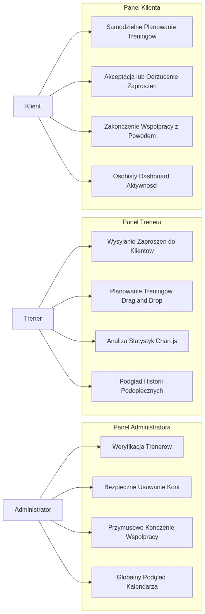
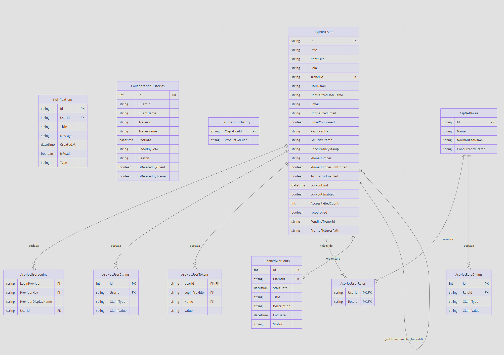
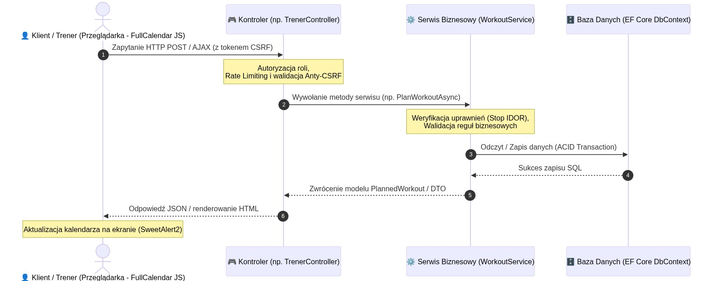

# Aplikacja Na Siłownię (Gym Management & Training Planner)

Stylowa, bezpieczna i wysoce zoptymalizowana aplikacja webowa do zarządzania planowaniem treningów oraz współpracą na linii **Klient - Trener - Administrator**. Projekt został zbudowany w oparciu o najnowocześniejszy stos technologiczny **.NET 10**, z zachowaniem najwyższych branżowych standardów bezpieczeństwa (cybersecurity), optymalizacji bazodanowej oraz wzorcowej architektury kodu.

Aplikacja idealnie nadaje się do zaprezentowania w profesjonalnym portfolio programistycznym (Portfolio-Ready).

---

## Główne Role i Funkcjonalności Systemu

Aplikacja dzieli uprawnienia na trzy niezależne role, ujednolicone w ramach jednego systemu bezpieczeństwa ASP.NET Core Identity:

### 1. Panel Administratora
*   **Weryfikacja Trenerów:** System autoryzacji "zero-trust" – nowo zarejestrowani trenerzy muszą zostać ręcznie zatwierdzeni przez administratora zanim uzyskają dostęp do systemu.
*   **Zarządzanie Użytkownikami:** Bezpieczne usuwanie użytkowników z automatycznym czyszczeniem zależności bazodanowych i generowaniem logów audytowych.
*   **Przymusowe Kończenie Współpracy:** Możliwość odpięcia klienta od trenera z podaniem oficjalnego powodu, który trafia do nienaruszalnej historii.
*   **Globalny Kalendarz:** Podgląd i edycja dowolnych treningów zaplanowanych w systemie.

### 2. Panel Trenera
*   **Zarządzanie Podopiecznymi:** Wysyłanie zaproszeń do wolnych klientów na siłowni, bez możliwości bezpośredniego "przejęcia" klienta bez jego zgody.
*   **Interaktywny Kalendarz Treningów:** Integracja z biblioteką **FullCalendar.js** do dynamicznego planowania, przeciągania (drag & drop) i edycji sesji treningowych przypisanych klientów.
*   **Rozbudowane Statystyki i Analityka:** Wizualizacja zaangażowania podopiecznych na wykresach słupkowych i kołowych za pomocą biblioteki **Chart.js** (wyłanianie lidera aktywności).

### 3. Panel Klienta
*   **Autonomia:** Samodzielne planowanie własnych treningów w osobistym kalendarzu.
*   **Zarządzanie Współpracą:** Akceptowanie lub odrzucanie zaproszeń od trenerów, a także możliwość zakończenia aktualnej współpracy.
*   **Bezpieczna Zmiana Hasła (Premium UI/UX):** Nowoczesny, trójpolowy formularz w profilu użytkownika oparty o SweetAlert2 i grupy wejściowe Bootstrap z wbudowanym, interaktywnym "oczkiem" do pokazywania/ukrywania wpisywanych znaków (ze zmianą koloru ikony na neonową zieleń w trybie widocznym).
*   **Statystyki Aktywności:** Dedykowany dashboard pokazujący historię i statusy treningów (zrealizowane, nadchodzące, odwołane).

### 4. System Powiadomień w Czasie Rzeczywistym (SignalR)
*   **Błyskawiczna Komunikacja:** Wdrożono zaawansowany system powiadomień live oparty o technologię WebSockets (ASP.NET Core SignalR). Użytkownicy natychmiast dowiadują się o kluczowych zdarzeniach (np. wysłanie zaproszenia, akceptacja lub odrzucenie zaproszenia, anulowanie współpracy przez drugą stronę).
*   **Dedykowane Przekierowania:** Kliknięcie powiadomienia w menu nawigacyjnym automatycznie przenosi użytkownika do odpowiedniej sekcji w systemie (np. administratora do widoku akceptacji trenerów, klienta do widoku zaproszeń).
*   **Wielopoziomowe Powiadomienia Systemowe:** Po zalogowaniu lub wylogowaniu użytkownicy otrzymują eleganckie komunikaty toast ("Wylogowano pomyślnie", "Zalogowano pomyślnie") w prawym górnym rogu ekranu, zintegrowane w całej aplikacji dla wszystkich ról.
*   **Interaktywny Dzwonek:** Wdrożono dynamiczny system animacji – po najechaniu kursorem na ikonę dzwonka w menu nawigacyjnym dzwonek rytmicznie dzwoni (obraca się w lewo i prawo), a pod nim wyświetla się czerwony licznik nieprzeczytanych wiadomości.

---

## Cyberbezpieczeństwo (Cybersecurity Hardening)

Projekt został zaprojektowany z myślą o pełnej obronie przed atakami z listy **OWASP Top 10**:

1.  **Pełna Obrona przed IDOR (Insecure Direct Object Reference):**
    *   Wszystkie zapytania AJAX oraz operacje w serwisach biznesowych są rygorystycznie weryfikowane na poziomie serwera. Trener nie ma technicznej możliwości podejrzenia statystyk ani modyfikacji kalendarza klienta, z którym nie ma aktywnej, zatwierdzonej współpracy.
2.  **Ochrona przed atakami Brute Force i DoS (Rate Limiting):**
    *   Wdrożono zaawansowaną politykę `RateLimiting` typu Fixed Window w ASP.NET Core. Endpointy rejestracji, logowania oraz zmiany hasła (w profilu) są chronione przed automatycznymi atakami słownikowymi (max 5 prób na 10 sekund z jednego adresu IP).
3.  **Twarde Zabezpieczenie Uploadu Plików (Magic Numbers Check):**
    *   Przesyłanie awatarów profilowych jest w pełni zabezpieczone: ograniczono rozmiar pliku (max 2MB), zastosowano whitelisting rozszerzeń oraz niskopoziomową weryfikację nagłówków bajtowych (MIME Magic Numbers) dla formatów PNG/JPEG. Całkowicie blokuje to próby wstrzyknięcia złośliwego kodu (atak *Polyglot Upload*).
    *   Pliki są zapisywane pod losowo generowanymi nazwami `Guid`, eliminując ryzyko podatności *Path Traversal*.
4.  **Zabezpieczenie przed atakami CSRF (Cross-Site Request Forgery):**
    *   Każde zapytanie modyfikujące dane (`POST`) posiada weryfikację tokenu antysfałszowaniowego. Skonfigurowano nagłówek `RequestVerificationToken`, umożliwiając bezproblemową współpracę z zapytaniami asynchronicznymi `fetch` w JavaScript.
5.  **Biała Lista Ról:**
    *   Serwer uniemożliwia eskalację uprawnień (Privilege Escalation) podczas rejestracji, sprawdzając dopuszczalne role po stronie backendu (zapobiega to wstrzyknięciu roli "Admin" przez narzędzia deweloperskie).

## Architektura i Diagramy UML (UML Diagrams)

W celu przejrzystego zwizualizowania procesów biznesowych, powiązań danych oraz mechanizmów bezpieczeństwa aplikacji, wdrożono pełną dokumentację projektową w postaci trzech kluczowych diagramów UML:

### 1. Diagram Przypadków Użycia (UML Use Case Diagram)
Obrazuje interakcję poszczególnych aktorów (Klient, Trener, Administrator) z kluczowymi modułami i funkcjonalnościami aplikacji:



### 2. Diagram Klas (UML Class Diagram)
Przedstawia strukturę danych, typy właściwości, metody oraz relacje między centralnymi encjami systemu (zarządzanymi przez Entity Framework Core):



### 3. Diagram Sekwencji (UML Sequence Diagram)
Prezentuje pełny cykl życia bezpiecznego zapytania AJAX (np. przy planowaniu nowego treningu) – od akcji w przeglądarce, przez wielopoziomowe filtry bezpieczeństwa, aż po transakcyjny zapis ACID w bazie danych:



---

## Architektura Bazy Danych i Wydajność (SQL Optimization)

*   **Database-Side Aggregation (IQueryable):** Wszystkie analityki i zapytania filtrujące są tłumaczone bezpośrednio na zapytania T-SQL i wykonywane po stronie bazy danych. Aplikacja nie pobiera zbędnych danych do pamięci RAM serwera.
*   **Indeksowanie Wydajnościowe:** 
    *   Dodano złożony indeks nieklastrowany `(ClientId, StartDate)` na tabeli `PlannedWorkouts`, drastycznie przyspieszając ładowanie dynamicznych kalendarzy i agregacji statystyk.
    *   Dodano złożony indeks nieklastrowany `(UserId, IsRead, CreatedAt)` na tabeli `Notifications`, który eliminuje narzut wyszukiwania i sortowania powiadomień w dzwoneczku, przenosząc te operacje w całości na poziom wydajnego indeksu w silniku SQL.
    *   Dodano indeksy na kluczach obcych tabeli logów historycznych.
*   **Optymalizacja Usług w Tle (Background Task Tuning):**
    *   Wprowadzono flagę logiczną `IsReminderSent` na poziomie modelu `PlannedWorkout`. Zastąpiło to kosztowne przeszukiwanie bazy danych zapytaniami tekstowymi `LIKE` (Contains na treści powiadomień) w usłudze w tle w celu weryfikacji, czy przypomnienie zostało już wysłane. Zapytanie jest teraz wykonywane w ułamku milisekundy.
*   **Bezpieczne Transakcje (ACID):** Wszystkie operacje modyfikujące powiązania między użytkownikami (np. usuwanie konta lub zakończenie współpracy) są obudowane w asynchroniczne transakcje bazodanowe (`BeginTransactionAsync`), co gwarantuje integralność danych w przypadku awarii serwera.
*   **Luźne Powiązanie Audytowe (Loose Coupling):** Tabela `CollaborationHistories` nie ma fizycznych powiązań kluczy obcych z tabelą użytkowników, aby usunięcie konta użytkownika nie niszczyło logów historycznych (uniknięcie problemu *Cascade Delete*).

---

## Standardy Kodowania (Clean Code)

*   **Modern C# i Range Operators:** Uproszczono operacje na tekście, rezygnując z przestarzałej metody `.Substring` na rzecz bezpiecznego i eleganckiego operatora zakresu `[..500]`, w pełni dostosowując kod do reguł analizy statycznej środowiska programistycznego.
*   **Optymalizacja Alokacji Pamięci (.NET Heap Tuning):** Zastąpiono alokujące zapytania rozszerzające LINQ `.Any()` bezpośrednim sprawdzeniem właściwości `.Count > 0` dla obiektów typu `List<T>`. Zapobiega to zbędnej alokacji obiektów iteratorów na stercie i odciąża proces Garbage Collectora przy częstych żądaniach w tle.
*   **Uelastycznienie Logiki Biznesowej (UX):** Wprowadzono bezpieczną obsługę wartości domyślnych przy zrywaniu współpracy. Jeśli powód nie zostanie podany przez użytkownika, system automatycznie podstawia bezpieczną frazę "Brak podanego powodu", zapobiegając blokowaniu operacji bazodanowych i poprawiając płynność UX.
*   **Primary Constructors (C# 12):** Zastosowanie nowoczesnego wstrzykiwania zależności w nagłówkach klas, co usuwa zbędny kod i podnosi czytelność.
*   **Timezone Normalization (`TimeHelper`):** Całkowicie wyeliminowano problem przesunięć stref czasowych serwera w chmurze (np. Azure/AWS). Klasa pomocnicza unifikuje czas do strefy polskiej (CET/CEST) zarówno w systemach Windows, jak i Unix/Linux.
*   **Brak Cichego Połykania Wyjątków:** Wszystkie transakcje raportują błędy przez wstrzyknięty interfejs `ILogger` z pełnym zrzutem śladu stosu (Stack Trace).
*   **Zero warnings:** Kod kompiluje się z wynikiem **0 błędów i 0 ostrzeżeń** (pełna higiena kodu zgodna z regułami analizatorów statycznych CA).
*   **Testy Jednostkowe:** Projekt zawiera dedykowany zestaw testów jednostkowych (xUnit) pokrywających krytyczną logikę autoryzacji oraz zarządzania transakcjami.

## Struktura Projektu (Project Structure)

Projekt jest zorganizowany zgodnie z najlepszymi praktykami architektury trójwarstwowej (MVC + Services) z zachowaniem pełnej separacji odpowiedzialności (Separation of Concerns):

```text
├── AplikacjaNaSiłownię/                 # Główny projekt aplikacji webowej
│   ├── Controllers/                     # Kontrolery MVC (obsługa żądań HTTP, CSRF, autoryzacja ról)
│   ├── Models/                          # Encje bazy danych EF Core, DTO oraz ViewModels
│   ├── Services/                        # Warstwa serwisu biznesowego (separacja logiki od kontrolerów, walidacja IDOR)
│   ├── Data/                            # Konfiguracja EF Core DbContext, indeksów bazodanowych i migracji SQL
│   ├── Helpers/                         # Klasy pomocnicze (np. TimeHelper stref czasowych)
│   ├── Views/                           # Widoki Razor (.cshtml) z pełnym podziałem na role (Admin, Trener, Klient)
│   └── wwwroot/                         # Zasoby statyczne (pliki CSS, JS, biblioteki JS, uploads)
│       └── images/                      # Wykresy, zrzuty ekranu oraz diagramy UML
│
└── AplikacjaNaSiłownię.Tests/           # Projekt testów jednostkowych (xUnit)
    ├── UserServiceTests.cs              # Pokrycie testowe logiki transakcyjnej i ról użytkowników
    └── WorkoutServiceTests.cs           # Pokrycie testowe logiki planowania sesji i weryfikacji IDOR
```

---

## Stos Technologiczny

*   **Backend:** .NET 10 Core (C# 12), Entity Framework Core 10
*   **Baza Danych:** MS SQL Server
*   **Frontend:** HTML5, CSS3 (Vanilla), JavaScript (ES6+ Fetch API), FullCalendar.js, Chart.js, SweetAlert2
*   **Testowanie:** xUnit, Moq, Entity Framework InMemory

---

## Instrukcja Uruchomienia Projektu

### Wymagania wstępne:
1.  Zainstalowane **.NET 10 SDK**.
2.  Zainstalowany **MS SQL Server** (LocalDB lub pełna edycja).

### Krok po kroku:
1.  **Sklonuj repozytorium:**
    ```bash
    git clone https://github.com/twoj-login/AplikacjaNaSilowniePortfolio.git
    cd AplikacjaNaSilowniePortfolio
    ```
2.  **Skonfiguruj połączenie z bazą danych:**
    *   Otwórz plik `appsettings.json` i upewnij się, że Connection String `AplikacjaNaSilownie_DB` wskazuje na Twój lokalny serwer SQL.
3.  **Uruchom migracje bazy danych (Dwie opcje do wyboru):**
    *   **Opcja A (Konsola w Visual Studio):** Otwórz *Konsolę Menedżera Pakietów (Package Manager Console)* w dolnym panelu i wpisz prostą komendę:
        ```powershell
        Update-Database
        ```
    *   **Opcja B (Zwykły Terminal/Git Bash):** Upewnij się, że masz zainstalowane narzędzie `dotnet-ef` (`dotnet tool install --global dotnet-ef`) i wpisz w folderze projektu:
        ```bash
        dotnet ef database update -p AplikacjaNaSiłownię
        ```
4.  **Uruchom testy jednostkowe:**
    ```bash
    dotnet test
    ```
5.  **Uruchom aplikację lokalnie:**
    ```bash
    dotnet run --project AplikacjaNaSiłownię
    ```
    Aplikacja uruchomi się pod adresem: `https://localhost:5001` (lub wskazanym w konsoli porcie HTTP).

### Domyślne Dane Logowania Administratora:
*   **Email:** `admin@system.local` (Nazwa użytkownika: `Admin`)
*   **Hasło:** `admin`

---

## Autor i Portfolio

Projekt został stworzony przez **Mateusza Przytułę** jako reprezentacyjny pokaz umiejętności programistycznych, dbałości o czystość kodu oraz standardy bezpieczeństwa.

*   **GitHub:** [Mateusz Przytuła (GitHub)](https://github.com/Mateuszxd322)

---

## Licencja

Projekt udostępniony na licencji **MIT**. Możesz go dowolnie modyfikować i używać w celach edukacyjnych oraz rekrutacyjnych.
